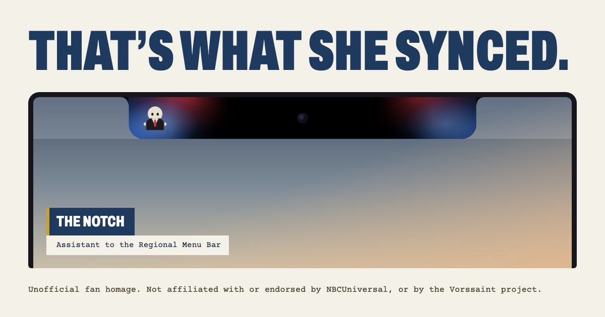

<a href="https://pravindurgani.github.io/thats-what-she-synced/"></a>

<p align="center"><strong>Your MacBook's notch, in sync with your music.</strong><br>
<a href="https://pravindurgani.github.io/thats-what-she-synced/">See it in action →</a></p>

| Genesis | Pink Floyd | Pink Floyd, one colour |
|:---:|:---:|:---:|
|  |  |  |

> **Unofficial.** Not made by or linked to [Vorssaint](https://github.com/vorssaint/vorssaint-utils), NBCUniversal or The Office. You build it yourself from this code; the official Vorssaint app is at [vorssaint.com](https://vorssaint.com).

## What you get

- 🎨 The notch takes the **colours of the album cover**
- 🥁 It **moves with the beat** and your volume
- 🕺 **Dancers** move to the music beside the camera
- ☕ An **Office character** keeps it company when nothing's playing
- 🤖 **Claude Code and Codex** each get a side while they work
- 📼 **Office-style alerts** for volume, charging, headphones, messages, calls and meetings

Works with Apple Music, Spotify, and music in Safari, Chrome or Firefox.

## Install

You need an Apple silicon Mac on macOS 14.4 or later, plus Apple's Command Line Tools (`xcode-select --install`).

1. **Build it:**
   ```bash
   git clone https://github.com/pravindurgani/thats-what-she-synced.git
   cd thats-what-she-synced
   VORSSAINT_DEV_OPTIMIZE=1 ./build.sh --dev --install
   ```
2. **Let it hear the beat:** System Settings → Privacy & Security → Screen & System Audio Recording → under *System Audio Recording Only*, turn on **Vorssaint (Developer)**.
3. **Switch on**, in the app's Settings: **Dynamic Island**, **Bars follow the music** and **Accessory alerts**. For the cast and the agents, also install **Companion** and **AI Agents** on the **Features** page.
4. **Play a song** and hover over the notch.

Also running the official Vorssaint? Quit it, so you don't get two islands.

## Make it yours

The characters and the dancers change with every song. To keep a favourite, pick it under **Companion** or **Music side** in the app's Settings.

<details>
<summary><strong>More switches</strong> (paste one line into Terminal, then reopen the app)</summary>

<br>

**One colour** instead of several:
```bash
defaults write com.vorssaint.utils.dev notchSongLook -string duotone
```

**No song colours:**
```bash
defaults write com.vorssaint.utils.dev notchSongModeEnabled -bool false
```

**No Office alerts:**
```bash
defaults write com.vorssaint.utils.dev notchOfficeModeEnabled -bool false
```

**No glow when nothing's playing:**
```bash
defaults write com.vorssaint.utils.dev notchIdleGlowEnabled -bool false
```

To undo one, run the same line with `vivid` or `true` at the end.
</details>

## Not working?

- **No beat?** Check step 2, then reopen the app.
- **Using Firefox?** Turn on *Find covers for Firefox and Zen* in the app's music settings.

## Update

```bash
git pull && VORSSAINT_DEV_OPTIMIZE=1 ./build.sh --dev --install
```

## Credits

Built on **[Vorssaint](https://github.com/vorssaint/vorssaint-utils)** by [@vorssaint](https://github.com/vorssaint). Give the original a ⭐. Inspired by [Atoll](https://github.com/Ebullioscopic/Atoll) and [boring.notch](https://github.com/TheBoredTeam/boring.notch), with no code taken from either. The name and the characters are a fan nod to *The Office* (US): our own drawings, no actors' likenesses or logos. Made with [Claude Code](https://claude.com/claude-code).

Licensed [GPL-3.0-or-later](LICENSE), like Vorssaint. The Vorssaint name and look belong to the Vorssaint project ([TRADEMARKS.md](TRADEMARKS.md)).
