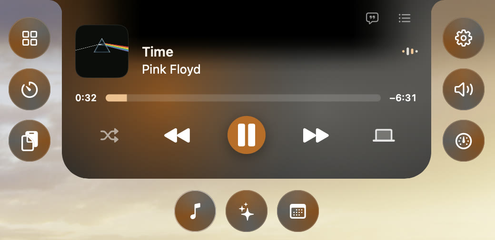

<h1 align="center">That's What She Synced</h1>

<p align="center"><strong>Your MacBook's notch, in sync with your music.</strong><br>
<a href="https://pravindurgani.github.io/thats-what-she-synced/">Watch the mockumentary →</a></p>

| Genesis · Vivid | Pink Floyd · Vivid | Pink Floyd · Duotone |
|:---:|:---:|:---:|
|  |  |  |

> **Unofficial** fork of [Vorssaint](https://github.com/vorssaint/vorssaint-utils), not affiliated with it, nor with NBCUniversal or The Office. Source only; the official app is at [vorssaint.com](https://vorssaint.com).

## What it does

- 🎨 **Album-art colours** on the island, its buttons and its text
- 🥁 **Moves with the music:** the beat, your volume, the genre and the cover's mood
- 🕺 **Dancers beside the camera** while a song plays: Boombox Boss, The Farewell Three or The Scarn
- ☕ **An Office cast** at rest, over a coloured glow: Agent Scarn, Goldenface, the Jelly Stapler, the Best Boss Mug and the Schrute Beet
- 🤖 **Claude Code and Codex** get a side each, with comet rings while they work
- 📼 **Office moments:** charging fills a coffee mug, earphones open Cafe Disco, and calls and meetings mean *"Conference room. Now."*

Works with Apple Music, Spotify, and music in Safari, Chrome or Firefox.

## Install

You need an Apple silicon Mac on macOS 14.4 or later, plus Apple's Command Line Tools (`xcode-select --install`).

1. **Build it:**
   ```bash
   git clone https://github.com/pravindurgani/thats-what-she-synced.git
   cd thats-what-she-synced
   VORSSAINT_DEV_OPTIMIZE=1 ./build.sh --dev --install
   ```
2. **Let it hear the beat:** System Settings → Privacy & Security → Screen & System Audio Recording → under *System Audio Recording Only*, turn on **Vorssaint (Developer)**.
3. **Switch on**, in the app's Settings: **Dynamic Island**, **Bars follow the music** and **Accessory alerts**. For the cast and the agents, also install **Companion** and **AI Agents** on the **Features** page.
4. **Play a song** and hover over the notch.

Also running the official Vorssaint? Quit it, so you don't get two islands.

## Options

The cast and the dancers shuffle with every song; pick a favourite under **Companion** and **Music side** in Settings. The rest are switches:

```bash
# Duotone: one accent colour from the cover, plus a neutral
defaults write com.vorssaint.utils.dev notchSongLook -string duotone
# Song colours off
defaults write com.vorssaint.utils.dev notchSongModeEnabled -bool false
# Office moments off
defaults write com.vorssaint.utils.dev notchOfficeModeEnabled -bool false
# Coloured glow at rest off
defaults write com.vorssaint.utils.dev notchIdleGlowEnabled -bool false
```

Reopen the app after a change. To undo, use `vivid` or `true`.

## Not working?

- **No beat?** Check step 2, then reopen the app.
- **No colours?** Black-and-white covers stay neutral; try a colourful album.
- **Firefox?** Turn on *Find covers for Firefox and Zen* in the app's music settings.

## Update

```bash
git pull && VORSSAINT_DEV_OPTIMIZE=1 ./build.sh --dev --install
```

## Credits

Built on **[Vorssaint](https://github.com/vorssaint/vorssaint-utils)** by [@vorssaint](https://github.com/vorssaint). ⭐ the original. It's inspired by [Atoll](https://github.com/Ebullioscopic/Atoll) and [boring.notch](https://github.com/TheBoredTeam/boring.notch), with no code taken from either. The name and the cast are a fan nod to *The Office* (US): original drawings, no likenesses or logos. Made with [Claude Code](https://claude.com/claude-code). Licensed [GPL-3.0-or-later](LICENSE), like Vorssaint, whose name and look belong to the Vorssaint project ([TRADEMARKS.md](TRADEMARKS.md)).
