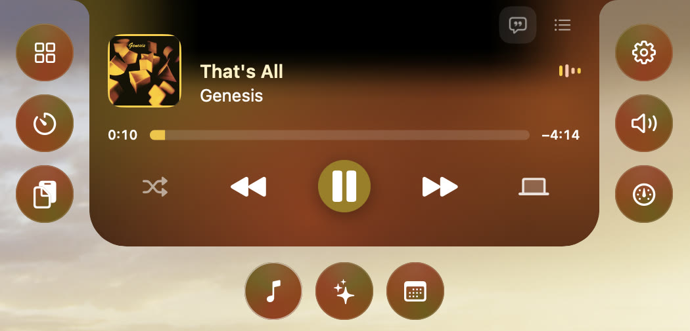
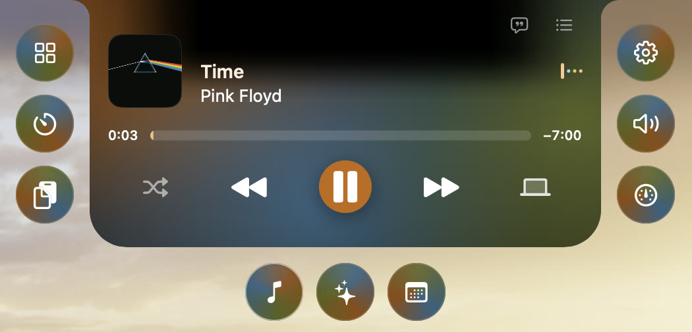

<h1 align="center">That's What She Synced</h1>

<p align="center"><strong>Your MacBook's notch, in sync with your music.</strong></p>

<p align="center">
  
  
</p>

> **Unofficial.** A personal fork of **[Vorssaint](https://github.com/vorssaint/vorssaint-utils)**, not affiliated with or endorsed by it. Source only, no builds. Get the official app at [vorssaint.com](https://vorssaint.com).

## What it does

- 🎨 **Takes the album art's colours.** The island, its buttons and its text glow in the cover's palette.
- 🥁 **Moves to the music.** It jumps on every beat, rises with your volume, and takes its character from the genre and the cover's mood.
- 🌙 **Even when closed.** The resting notch glows softly with the song.
- 🤖 **Your companion dances.** It wears the song's colours and bops to the beat.
- 🎧 **Connect moment.** Plugging in or pairing headphones opens the island into an animated card.

It works with Apple Music, Spotify, Safari, Chrome and Firefox. Text stays readable, it respects Reduce Motion, and nothing leaves your Mac.

## Install

You need an Apple silicon Mac on macOS 14.4 or later, with Apple's Command Line Tools (`xcode-select --install`).

```bash
git clone https://github.com/pravindurgani/thats-what-she-synced.git
cd thats-what-she-synced
VORSSAINT_DEV_OPTIMIZE=1 ./build.sh --dev --install
```

Then:

1. Open **System Settings → Privacy & Security → Screen & System Audio Recording**. Under **System Audio Recording Only**, allow **Vorssaint (Developer)**. This lets it hear the beat.
2. In the app's Settings, turn on **Dynamic Island**, **Bars follow the music** and **Accessory alerts**.
3. Play a song and hover over the notch.

It installs alongside the official Vorssaint as a separate app, so quit that one to avoid two islands. To update, run `git pull` and the build command again.

## Options

```bash
# Duotone: one accent colour from the cover plus a neutral
defaults write com.vorssaint.utils.dev notchSongLook -string duotone   # back: vivid

# Song mode off entirely
defaults write com.vorssaint.utils.dev notchSongModeEnabled -bool false  # back: true
```

Quit and reopen the app after changing either one.

<p align="center"></p>

## Not working?

- **No beat:** allow System Audio Recording (step 1) and turn on **Bars follow the music**, then reopen the app.
- **No colours:** black-and-white covers stay neutral on purpose. Try a colourful album.
- **Firefox shows plain colours:** it shares no cover art with macOS. Turn on **Find covers for Firefox and Zen** in the app's music settings.

More in Vorssaint's [troubleshooting guide](docs/TROUBLESHOOTING.md).

## Credits

- **[Vorssaint](https://github.com/vorssaint/vorssaint-utils)** by [@vorssaint](https://github.com/vorssaint), the app this is built on. ⭐ the original.
- Inspired by the Mac notch community, especially [Atoll](https://github.com/Ebullioscopic/Atoll) and [boring.notch](https://github.com/TheBoredTeam/boring.notch). No code was taken from either.
- The name is a nod to Michael Scott. Made with [Claude Code](https://claude.com/claude-code).

## Licence

[GPL-3.0-or-later](LICENSE), like Vorssaint. The Vorssaint name and look belong to the Vorssaint project; see [TRADEMARKS.md](TRADEMARKS.md).
