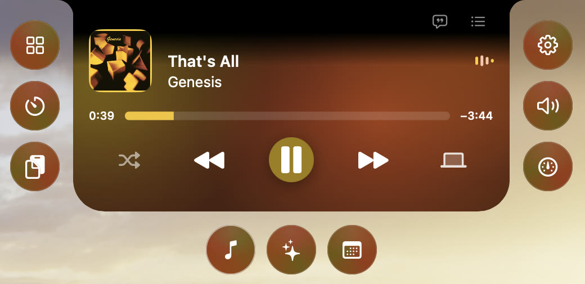
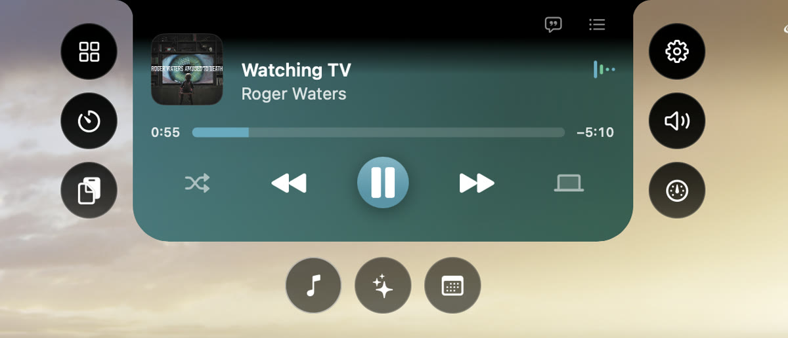
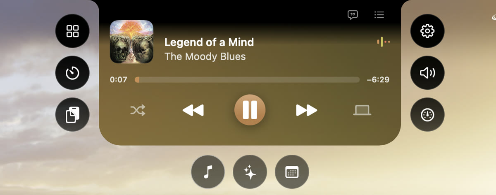
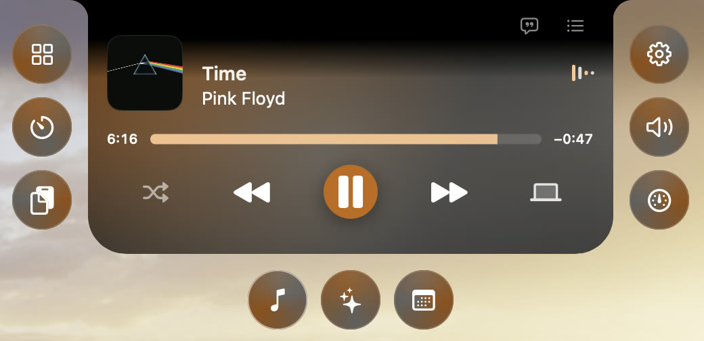

<h1 align="center">That's What She Synced</h1>

<p align="center"><strong>Your MacBook's notch, in sync with your music.</strong><br>
The island takes the colours of the song you're playing, and moves with its beat, its genre and your volume.</p>

<p align="center">
  
</p>

<p align="center">
  
  
</p>

> **Unofficial.** This is a personal fork of **[Vorssaint](https://github.com/vorssaint/vorssaint-utils)**. It is not affiliated with, or endorsed by, the Vorssaint project. Source only: no builds are distributed here. Official Vorssaint comes only from its maintainer, at [vorssaint.com](https://vorssaint.com).

---

## What it adds

Everything below sits on top of Vorssaint's Dynamic Island and only touches music, volume and audio-device visuals.

| | |
|---|---|
| **🎨 Album-art aurora** | Open the island while music plays, and it fills with soft pools of colour taken from the album cover. They drift and breathe on slow loops that never visibly repeat. A new song cross-fades in with a brief bloom; pausing settles and dims it. |
| **🥁 Moves with the beat** | It listens for onsets (kicks, snares, chord hits), not just loudness. On each one the light jumps up, swells and bursts in the cover's colours, then falls back like a VU meter. |
| **🎚️ Your volume is the dial** | Louder raises the light and lets it hit harder; quieter calms it to a glow. Muted, it rests. |
| **🎸 Genre and mood set the character** | Apple Music's genre picks the motion: calm music (classical, jazz, ambient) drifts slowly, groove (hip-hop, R&B, funk) follows the bass, drive (rock, metal, indie) hits harder, and pulse (electronic, dance, pop) is fastest. Every song also gets a mood from its cover, on any player: dark, muted covers move calmer, and bright, vivid ones livelier. |
| **💿 The whole island wears it** | While a song plays, every page (calendar, agents, clipboard, the explorer and the rest) and every button around the island take the same colours. The buttons turn slowly like records, stop when you pause, pulse on the beat, and melt back into the island as it closes. |
| **🔤 Words in the song's colours** | Text across the island takes a tint of the cover: a near-white for headlines, and a brighter, coloured tone for the softer lines, which reads better over the colour than plain grey. No song, no change. |
| **🤖 Your companion dances** | The robot (or whichever companion you picked) wears the cover's colours while a song plays and bops and sways to the beat, swinging the other way on every hit. |
| **🌙 Even closed** | The closed island glows in the song's colours too, drifting and swelling softly on the beat. Since it's always in view, it never flashes. |
| **🎶 A moment for every new song** | When the track changes, the strip blooms into the new cover's colours. The cover springs in like a record dropping onto the platter, and the title and artist drift in after it. |
| **🌈 Everything in the song's colours** | Equalizer bars, the progress bar, the play button and the volume meter all take the cover's palette. With nothing playing, they use your companion's colours. |
| **🎧 Connect moment** | When earphones or headphones connect (wired, USB or Bluetooth), the island opens into a card within about a third of a second. The device icon springs in, sound-wave rings ripple out of it, and one sweep of colour crosses the island. Speakers get it too, once your Mac switches its sound to them. |

## How it works

```
album cover ──▶ 3 vivid colours ──▶ toned for each role (backdrop · marks · play button)
live audio  ──▶ beat onsets (spectral flux, 20 Hz) ──▶ jump · swell · colour burst
volume      ──▶ resting height + intensity
genre       ──▶ drift speed + how hard the light answers
```

- **Colours** come from a 24×24 sample of the cover, grouped by hue, keeping the most vivid distinct colours. Black-and-white covers stay neutral.
- **Beats** come from Vorssaint's existing live audio levels: how much each frequency band jumps from one reading to the next, weighted toward the bass, compared with its own recent average.
- **Genre** is read from Apple Music on your Mac, and only if you've already allowed the app to control Music. It never asks on its own.

## Built to be calm and kind

- **Readable:** the player's text stays above **WCAG 2.2 AA** contrast over every colour, beat peaks included. Other pages wear the colour vividly by default: white text stays far above AA, softer grey text sits around 4:1. Turn on **Increase Contrast** in macOS (Accessibility → Display), and every page keeps full AA.
- **Safe:** colour bursts stay under three per second, the limit for flashing content.
- **One flow, no cuts:** every place the island wears the song shares one aurora and one fade, so switching pages, opening and closing never cut it. It looks the same on every Space and every display the island opens on.
- **Reduce Motion respected:** no drift, turning, bounce, bursts or rings, just colour cross-fades and fades.
- **Light on battery:** the motion runs on Core Animation in the system's render server. It stops whenever the song is paused, the island is hidden or covered, or the screen sleeps.
- **Private:** everything happens on your Mac. Nothing is sent anywhere.

## Get it running (about five minutes)

**You need** an Apple silicon Mac on macOS 14 or later (14.4 or later for the beat), and Apple's free Command Line Tools. If you've never built code on this Mac, run `xcode-select --install` once first.

### 1. Build and install

```bash
git clone https://github.com/pravindurgani/thats-what-she-synced.git
cd thats-what-she-synced
VORSSAINT_DEV_OPTIMIZE=1 ./build.sh --dev --install
```

The first build takes a few minutes. It installs **Vorssaint (Developer)** in your Applications folder and opens it. If it doesn't open, run `open "/Applications/Vorssaint (Developer).app"`.

### 2. Let it hear the beat

Open **System Settings → Privacy & Security → Screen & System Audio Recording**. Under **System Audio Recording Only**, turn on **Vorssaint (Developer)**.

It only reads how loud each part of the sound is, to find the beat. Nothing is recorded, saved or sent anywhere.

### 3. Check three switches

In the app's **Settings**, make sure these are on:

- **Dynamic Island**
- **Bars follow the music**
- **Accessory alerts**, for the headphone and speaker card

While you're there, **General → Launch at login** keeps it running after a restart.

### 4. Play something

Play a song, hover over the notch, and turn it up. 🎶

**Works with** Apple Music, Spotify, and music or video in Safari, Chrome and Firefox:

- **Colours** come from the cover. Firefox shares no cover with macOS, so there the island grows colours from your companion's instead. For the real cover, turn on **Find covers for Firefox and Zen** in the app's music settings; it looks the cover up online.
- **The beat** follows whatever your Mac is playing.
- **Genre-aware motion** is Apple Music only. The first time you press play from the island, allow it to control **Music**.

### Choose your look

<p align="center">
  
</p>

- **Vivid** (the default) uses the cover's whole palette, everywhere.
- **Duotone** takes just the cover's lead colour as one accent, with a soft neutral for everything else. It has the same motion, with much less colour.

```bash
defaults write com.vorssaint.utils.dev notchSongLook -string duotone
```

Quit and reopen the app. Use `vivid` to switch back.

### Already use Vorssaint?

This installs as a separate app, with its own settings, next to the official one. Quit the official app, or turn off its Dynamic Island, so you don't get two islands.

### Update or remove

- **Update:** `git pull && VORSSAINT_DEV_OPTIMIZE=1 ./build.sh --dev --install`
- **Remove:** quit it and delete `/Applications/Vorssaint (Developer).app`. The build also made a local signing key so your permissions survive rebuilds; delete `~/Library/Keychains/vorssaint-signing.keychain-db` too if you're done for good.

### Something not right?

| You see | Try this |
|---|---|
| No colours | Black-and-white covers stay neutral on purpose. Try a colourful album, and check **Dynamic Island** is on. |
| Firefox shows my companion's colours, not the cover's | Firefox shares no cover with macOS. Turn on **Find covers for Firefox and Zen** in the app's music settings. |
| Colours, but no beat | Allow **System Audio Recording** (step 2) and turn on **Bars follow the music**, then quit and reopen the app. |
| Every genre moves the same | Allow Vorssaint (Developer) to control Music in **System Settings → Privacy & Security → Automation**. |
| No card when headphones connect | Turn on **Accessory alerts**. The card skips devices that were already connected when the app started, and stays quiet over full-screen apps. |
| Too much colour | Try **Duotone** (see *Choose your look*). For calmer pages only, turn on **Increase Contrast** (System Settings → Accessibility → Display). |

For more, see Vorssaint's own [troubleshooting](docs/TROUBLESHOOTING.md), [permissions](docs/PERMISSIONS.md) and [build](CONTRIBUTING.md) notes.

### Switch song mode off

```bash
defaults write com.vorssaint.utils.dev notchSongModeEnabled -bool false
```

Quit and reopen the app. Use `true` to bring it back.

This turns off the island's colour, glow, buttons, text tints and the dancing companion. The player keeps its cover-coloured controls, and the connect card follows **Accessory alerts**.

## Credits

- **[Vorssaint](https://github.com/vorssaint/vorssaint-utils)** by [@vorssaint](https://github.com/vorssaint) — the app, the Dynamic Island, the companion, the live audio levels, the mixer, and everything this builds on. This fork is about 1% new code on top of a lot of excellent work. If you like this, ⭐ and support the original.
- **Inspiration:** the Mac notch community, especially [Atoll](https://github.com/Ebullioscopic/Atoll) and [boring.notch](https://github.com/TheBoredTeam/boring.notch). No code was taken from either.
- **The name:** a nod to Michael Scott and *The Office* (US).
- **Made with** [Claude Code](https://claude.com/claude-code), with every change independently reviewed before release.

## Licence

**GPL-3.0-or-later**, the same as Vorssaint; see [`LICENSE`](LICENSE). The licence covers the source code only. The Vorssaint name, logo and look belong to the Vorssaint project; see [`TRADEMARKS.md`](TRADEMARKS.md). This fork uses its own name and distributes no builds.

<p align="center"><sub>Made by <a href="https://github.com/pravindurgani">@pravindurgani</a>. Turn it up. 🎶</sub></p>
